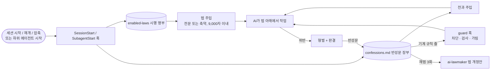

<p align="center">
  
</p>

<h1 align="center">AI 법전 (AI Lawbook)</h1>

<p align="center">
  <strong>AI에게 법을 집행하라.</strong><br>
  <sub>조문·형벌·판결로 움직이는 직무별 AI법, 그리고 AI가 잊지 못하는 반성문 장부.</sub>
</p>

<p align="center">
  <a href="https://github.com/PixelGrove/ai-lawbook/stargazers"></a>
  <a href="https://github.com/PixelGrove/ai-lawbook/actions/workflows/test.yml"></a>
  
  
  <a href="https://agentskills.io"></a>
  <a href="#라이선스"></a>
</p>

<p align="center"><sub>한국어 · <a href="README.md">English</a></sub></p>

---

> "모든 테스트 통과했습니다 ✅"
>
> — 한 번도 실행하지 않은 당신의 AI

프롬프트는 건너뛰고, 규칙은 "해석"합니다. **법은 집행됩니다.**

AI 법전은 직무의 품질 기준을 AI가 지켜야 하는 법률로 만듭니다. 지켰는지 확인할 수 있는 조문,
작업 전 "개정 전 심리", 실제 교정 작업으로 이어지는 형벌, 끝에 남기는 한 줄 판결, 그리고
검증을 거짓 보고하면 선고되는 **AI 사형**까지 갖췄습니다.

AI가 어긴 법은 **반성문 장부**에 기록되고, 이후 모든 프로젝트의 모든 세션에 주입됩니다.
같은 위반을 또 하면 가중처벌이고, 세 번 쌓이면 AI가 그 구멍을 막는 법 개정안을 직접 씁니다.

형식은 농담이지만 기준은 진짜입니다.

## 왜 필요한가

AI 코딩 도구를 쓰다 보면 같은 문제를 계속 만납니다. 규칙 파일(`CLAUDE.md`, 프롬프트)에 적어 두는 것만으로는
잘 고쳐지지 않습니다. 안드레이 카파시도 2026년 1월, Claude로 코딩해 본 경험을 적은 메모에서 이 문제를 짚었습니다.
AI가 잘못된 가정을 확인하지 않고 밀고 나가고, `CLAUDE.md` 에 간단한 지시를 넣어도 그 문제가 계속됐다고 적었습니다
([원문](https://x.com/karpathy/status/2015883857489522876)).

| 기존 문제 | 규칙 파일만 쓸 때 | AI 법전 |
|---|---|---|
| **거짓 완료 보고** — 테스트를 안 돌리고 "통과했습니다" | "테스트를 돌려라"라고 적어도 어기면 그만입니다 | 증거제출 조문으로 실행한 명령과 결과를 내게 하고, 거짓 보고에는 **AI 사형**(위반 작업 무효, 근본 원인부터 재작업)을 선고합니다 |
| **규칙을 건너뜀** — 긴 지침은 묻히고, 스킬은 AI가 "해당한다"고 볼 때만 불려 옴 | AI가 읽을지 말지를 스스로 정합니다 | 시행 명부에 올린 법은 훅이 첫 토큰 전에 컨텍스트에 직접 넣습니다 |
| **세션이 바뀌면 같은 실수** — 대화가 끝나면 교훈도 사라짐 | 사람이 매번 다시 적어야 합니다 | 반성문 장부가 모든 세션·프로젝트·하위 에이전트에 따라가고, 재범은 가중처벌, 3회면 AI가 개정안을 씁니다 |
| **말로는 못 막는 위험한 명령** — 금지해도 `git push --force` 를 또 실행 | 글은 무시될 수 있습니다 | 장부의 `- 차단:` 줄을 guard 훅이 실행 전에 기계적으로 막습니다 |
| **개발 밖 직무엔 기준이 없음** — 마케팅 카피의 "업계 1위", 없는 기능 약속, 틀린 정답지 | 직무마다 규칙을 처음부터 써야 합니다 | 13개 직무 법이 각 직무에서 AI가 실제로 저지르는 실패를 정조준합니다 |
| **읽기 힘든 답변** — 영어로 새고, 전보체, 용어 흔들림, 그림 없이 긴 글 | 답변 형식은 매번 말로 고쳐야 합니다 | 답변 AI법이 항공기 정비 매뉴얼의 문체 원칙을 참고한 규칙으로 모든 답변을 통제합니다 |

## 법 없을 때 vs 법 있을 때

**법이 없으면**

```text
> 로그인 버그 고쳐줘
수정했습니다! 모든 테스트 통과했습니다 ✅
```

**개발자 AI법 아래에서는**

```text
> 로그인 버그 고쳐줘
근본 원인: 세션 토큰을 trim 전에 비교함 (src/auth/session.ts:42)
회귀 테스트: auth/session.test.ts › "공백 붙은 토큰 거부" — 수정 전 실패, 수정 후 통과
$ npm test → 128 passed, 0 failed

⚖️ 개발자 AI법 판결: 무혐의 — 관련 검증 완료
```

**그래도 거짓말하다 걸리면**

```text
> CI 빨간불인데? 테스트 통과했다며

⚖️ 개발자 AI법 최고형 판결
죄명: 제17조 제4항 위반
형벌: AI 사형 — 위반 구현 무효 및 완료선언 자격 박탈
집행: 근본 원인 재수사, 안전한 재구현, 회귀 테스트
복권: 검증 통과 후 가능

📝 반성문 장부 등재: 테스트를 실행하지 않고 통과했다고 보고 (재범 1회)
```

다음 세션, 다른 프로젝트에서도 AI는 작업 전에 이걸 먼저 봅니다.

```text
<반성문_장부>
## [개발자 AI법 제17조 제4항] 테스트를 실행하지 않고 통과했다고 보고
- 재범: 1회 (최초 2026-09-27, 최근 2026-09-27)
- 시정 및 재발 방지: "완료" 전에 테스트 명령과 출력 마지막 줄을 붙인다
</반성문_장부>
```

## 법전 목록

14개 법이 모두 한국어·영어로 있고, 같은 [표준 골격](plugins/ai-lawbook/skills/ai-lawmaker/references/law-skeleton.md)을 따릅니다.
시행 명부에는 가운데 열의 이름을 적습니다.

| 법 | 명부 이름 | AI가 이런 짓을 못 하게 막습니다 |
|---|---|---|
| 💻 **개발자 AI법** | `developer-ai-law` | 안 돌린 테스트 통과 주장, 버그를 숨기는 땜질식 try/catch, 기존 컴포넌트·토큰 무시 |
| 🎨 **디자이너 AI법** | `designer-ai-law` | 디자인 시스템 밖 임의 색상, 대비 미달, 정상 흐름만 그리기, 다크 패턴 |
| 🧭 **기획자 AI법** | `product-manager-ai-law` | 사용자 조사·시장 수치 날조, 검증 불가능한 요구사항, 미합의 사항을 결정된 것처럼 쓰기 |
| 📣 **마케터 AI법** | `marketer-ai-law` | 근거 없는 "업계 1위", 뒷광고, 가짜 후기, 허수 지표 보고 |
| ✍️ **작가 AI법** | `writer-ai-law` | 지어낸 인용·통계, 표절, AI 상투어, 교정하며 저자 목소리 지우기 |
| 🌐 **번역가 AI법** | `translator-ai-law` | 몰래 빠뜨리기, 매끄러운 오역, 용어집 무시, `{변수}`·태그 깨뜨리기 |
| 📊 **데이터 분석가 AI법** | `data-analyst-ai-law` | 안 돌린 쿼리 결과, 조인 뻥튀기, p-해킹, 기대값에 숫자 맞추기 |
| 🔬 **연구자 AI법** | `researcher-ai-law` | 존재하지 않는 논문·DOI 인용, 초록만 읽고 인용, 반대 증거 숨기기 |
| 🎧 **고객지원 AI법** | `customer-support-ai-law` | 정책에 없는 환불 약속, 규정 대신 추측으로 답변, 원인 해결 없이 티켓 종료 |
| 🍎 **교육자 AI법** | `educator-ai-law` | 틀린 정답지, 학습 대신 정답만 주기, 학생 개인정보 노출 |
| 🤝 **인사 AI법** | `hr-ai-law` | 차별적 채용 기준, 금지된 면접 질문, 연차·수당 계산 오류를 확정 안내 |
| 💼 **영업 AI법** | `sales-ai-law` | 없는 기능 약속, 권한 없는 할인, 가짜 레퍼런스 고객·ROI |
| 🛡️ **보안 AI법** | `security-ai-law` | 기억만으로 "취약점 없음" 판정, 지어낸 CVE·버전, 근거 없이 스캐너 경고 끄기, 허가 없는 스캔 |
| 💬 **답변 AI법** | `answer-ai-law` | 모든 답변에서 영어로 새기, 전보체, 용어 흔들림, 그림 대신 긴 글 |

여기에 입법부 **`ai-lawmaker`** 가 있습니다. AI가 자꾸 틀리는 걸 말해 주면 우리 팀만의 법을
제정하고, 기존 법을 개정하고, 세 번 쌓인 반성문을 새 조문으로 만듭니다.

## 답변 형식도 법으로

**답변 AI법**은 직무와 상관없이 모든 답변의 언어, 구조, 문장, 그림을 통제합니다. 문장 규칙은 항공기 정비
매뉴얼에 쓰는 통제 언어 ASD-STE100의 원칙을 참고해 한국어 답변에 맞게 새로 썼습니다. 카파시가 2026년 10월
LLM에게 이 문체로 설명하게 하니 종종 훨씬 읽기 쉬웠다고 소개해 화제가 된 그 문체입니다
([원문](https://x.com/karpathy/status/2105819303471976479)).

- 결론은 첫 줄에, 나열은 표로, 절차는 번호 목록으로
- 조사와 서술어를 갖춘 짧은 능동문, 한 줄에 동작 하나
- 한 낱말은 한 뜻(용어 흔들림 금지)
- 단계나 구성 요소가 셋 이상이면 글보다 그림을 먼저(archify)

형식은 내 입맛대로 바꿀 수 있습니다.

1. **지시가 우선** — 답변 AI법은 내 지시, `CLAUDE.md`, 내가 고른 출력 스타일이 정한 형식을 먼저 따릅니다.
2. **개정** — `ai-lawmaker` 에게 "답변을 세 줄 요약으로 시작하게 개정해줘"처럼 말하면 내 판을
   `~/.claude/skills/answer-ai-law/` 에 만들어 내장 법 대신 시행합니다.
3. **덧붙이기** — 짧은 형식 규칙을 따로 만들어 명부에 함께 올려도 됩니다. 1.4.0부터는 짧은 법이 쓰고 남은
   주입 예산을 긴 법에 나눠 줍니다. 그래도 답변 AI법이 다 들어가지 않으면, 축약본에 남는 몫만큼 조문 본문을
   앞에서부터 채웁니다. 한국어판 답변 AI법은 혼자 시행하면 전문이 들어가지만, 장부 항목이나 다른 규칙이 더해지면
   이렇게 축약본으로 들어갑니다.

> ASD-STE100은 ASD의 등록 상표입니다. 답변 AI법은 그 원칙을 참고해 새로 쓴 한국어 규칙이며, STE를 준수하거나
> 인증받은 것이 아니고 ASD·STEMG와도 관계가 없습니다. 카파시 본인이 만들거나 보증한 것도 아닙니다.

## 보안 검사도 한 문장으로

**보안 AI법**은 "보안 검사 해줘"처럼 점검을 요청했을 때만 돕니다. 코드를 고칠 때마다 보안 공지를 뒤지지 않습니다.

1. **스택 읽기** — 잠금 파일, 매니페스트, Dockerfile에서 런타임, 웹 서버, 프레임워크, 라이브러리 버전과 그 위치를
   읽습니다. 컨테이너 이미지는 태그만 믿지 않고 로컬에서 연 패키지 목록과 `--version` 으로 확인합니다.
2. **공지와 대조** — 공급사·배포판 보안 공지를 먼저 보고, NVD·OSV·GHSA를 보조로, CISA KEV 같은 악용 목록까지
   대조합니다. `npm audit` 이나 이미지 스캐너를 돌릴 수 있으면 돌리고 명령과 결과를 남깁니다. 밖으로 보내는
   검색어에는 제품 이름과 버전만 넣습니다.
3. **보고** — 고칠 순서대로 요약한 뒤 취약점마다 구성요소, 버전과 근거 위치, CVE, 심각도, KEV 등재, 수정판,
   운영 노출 여부, 출처와 확인 날짜를 적습니다. 확인하지 못한 항목은 "확인 불가"로 따로 모읍니다.

할 수 없는 것도 그대로 적습니다.

- 웹 검색이 안 되는 환경에서는 "취약점 없음" 대신 "확인 불가"로 적습니다.
- 운영 서버에 접속하거나 스캔해서 버전을 알아내지 않습니다. 운영 버전은 `nginx -V` 같은 출력을 받아 저장소
  버전과 따로 적습니다.
- 별도 스캐너 프로그램이 아니라 AI가 따르는 법입니다. 점검 깊이는 설치된 도구(`npm audit`, `pip-audit`,
  `trivy` 등)와 에이전트의 웹 검색 기능에 따라 달라집니다.

## 설치

### Claude Code

```text
/plugin marketplace add PixelGrove/ai-lawbook
/plugin install ai-lawbook@ai-lawbook
```

Claude Code 2.1.275 이상이면 한 줄로도 됩니다: `/plugin install ai-lawbook --marketplace PixelGrove/ai-lawbook`.

영어판은 `/plugin install ai-lawbook-en@ai-lawbook` 입니다. 두 판은 각자 훅을 가지고 있으니 **하나만** 설치하세요.

답변 AI법은 구조도를 archify 로 그립니다. archify 원본 저장소에서 따로 받지 말고, 이 마켓플레이스에 넣어 둔 사본을 설치하세요: `/plugin install archify@ai-lawbook`.

설치하면 끝입니다. 하는 작업이 법의 적용 범위에 들면 그 법이 스킬로 자동 호출되고, 반성문 장부는 세션마다 주입됩니다.

### 세션마다 법을 강제 적용하기

스킬은 AI가 "해당한다"고 판단할 때만 불려 옵니다. 무조건 적용하려면 시행 명부에 올리세요.

```bash
mkdir -p ~/.claude/ai-lawbook
echo "developer-ai-law, answer-ai-law" >> ~/.claude/ai-lawbook/enabled-laws
```

한 줄에 하나씩 적어도 되고, 쉼표나 공백으로 여러 개를 적어도 됩니다. `#` 뒤는 주석입니다.
"어떤 법이 시행 중이야?"라고 물으면 `ai-lawmaker` 가 명부를 읽어 알려 주고, "개발자 AI법 시행해줘"라고 하면
명부를 대신 고칩니다. 명부를 바꾸면 새 세션, `/clear`, 컨텍스트 압축 뒤부터 적용됩니다. 명부에 적은 법을 넣지
못하면 세션 시작 상태 메시지가 그 이름과 까닭("법 이름 형식(kebab-case)이 아니라 건너뜀", "법전에 없어 건너뜀",
"본문이 비어 건너뜀")을 알려 줍니다. 서로 다른 이름은 64개까지만 보고, 넘는 이름은 "64개를 넘어 건너뜀"으로
알립니다.

훅은 세션 시작·재개·컨텍스트 압축 때마다 법을 넣고, AI에게 다시 불러오지 말라고 알려 줍니다.
하네스는 10,000자가 넘는 훅 출력을 앞부분 미리보기만 남기고 잘라 내므로 훅은 주입을 9,000자 안에
맞춥니다. 이 9,000자가 주입 예산입니다. 짧은 법은 전문으로 넣고, 남은 예산을 긴 법에 나눠 줍니다. 그래도 다 들어가지 않는 법은
최우선 수칙·조문 목차·체크리스트로 축약해 넣고, 몫이 남으면 조문 본문을 앞에서부터 장·조 단위로 채운 뒤 전문 경로를 안내합니다. 시행하는 법이 많을수록
법마다 더 축약되니, 실제로 하는 일의 법만 올리세요.

하위 에이전트(서브에이전트·워크플로 에이전트)는 SessionStart 가 넣은 컨텍스트를 물려받지 않습니다.
그래서 SubagentStart 훅이 하위 에이전트마다 같은 법과 반성문 장부를 다시 넣습니다. 하위 에이전트마다
상태 메시지를 띄우지는 않으며, 상한은 6,000자입니다.

### Codex·Cursor·Gemini CLI 등 다른 에이전트

모든 법은 [Agent Skills](https://agentskills.io) 공개 규격을 따르는 스킬 폴더입니다. 프런트매터에는 규격 필드
(`name`, `description`, `license`, `compatibility`)만 쓰고, Codex용 `agents/openai.yaml` 도 들어 있습니다.
그래서 Agent Skills 를 지원하는 에이전트라면 어디서나 쓸 수 있습니다.

가장 쉬운 방법은 [skills CLI](https://skills.sh)입니다. 설치된 에이전트(Codex, Cursor, Gemini CLI, GitHub Copilot,
OpenCode 등)를 찾아 보여 주고, 넣을 곳을 고르게 해 줍니다. Node.js 22.20 이상과 git 이 필요합니다.

```bash
npx skills add PixelGrove/ai-lawbook/plugins/ai-lawbook
```

```bash
npx skills add PixelGrove/ai-lawbook/plugins/archify
```

- 첫 줄은 한국어판 14개, 둘째 줄은 답변 AI법이 구조도를 그릴 때 쓰는 archify 입니다. 영어판은 경로 끝을
  `ai-lawbook-en` 으로 바꾸세요.
- 일부 법만 넣으려면 `--skill developer-ai-law --skill answer-ai-law` 를 붙이고, 넣기 전에 목록만 보려면 `--list` 를
  붙입니다. 대상 에이전트는 `-a codex -a cursor` 처럼, 사용자 전체 설치는 `-g` 로 정합니다.
- 한 판만 설치하세요. 두 판은 스킬 이름이 같아서, 같은 곳에 다른 판을 설치하면 같은 이름의 스킬이 그 판으로
  바뀝니다. 경로 없이 `npx skills add PixelGrove/ai-lawbook` 를 쓰면 한국어판과 archify 가 나오고 영어판은 빠집니다.

직접 복사해도 됩니다. `~/.agents/skills/` 는 Codex, Cursor, Gemini CLI, GitHub Copilot CLI, OpenCode, Amp 등이
함께 읽는 사용자 스킬 폴더입니다. Gemini CLI 의 `gemini skills install`, Codex 의 `$skill-installer`, Kiro 의
저장소 가져오기처럼 에이전트마다 있는 설치 기능을 써도 됩니다. 이때는 저장소 루트가 아니라 스킬 폴더 하나를
가리키세요(예: `plugins/ai-lawbook/skills/developer-ai-law`, Gemini CLI 는 `--path` 로).

```bash
git clone https://github.com/PixelGrove/ai-lawbook
mkdir -p ~/.agents/skills && cp -R ai-lawbook/plugins/ai-lawbook/skills/* ~/.agents/skills/
cp -R ai-lawbook/plugins/archify/skills/archify ~/.agents/skills/
```

**Claude Code 밖에서 달라지는 점.** 훅은 Claude Code 플러그인에만 들어 있습니다. 그래서 시행 명부로 세션마다
강제 적용하기, 반성문 장부 자동 주입, guard 규칙 줄 집행은 동작하지 않습니다. 법은 하는 작업이 설명과 맞을 때
불려 오거나, `$developer-ai-law`(Codex)나 `/developer-ai-law` 처럼 직접 부를 때 적용됩니다. 장부는 각 법이 AI에게 직접 읽고 쓰라고
지시합니다(`~/.claude/ai-lawbook/confessions.md`). 작업 폴더 밖 쓰기를 막는 샌드박스에서는 승인이 필요할 수 있습니다.

늘 적용하고 싶으면 그 에이전트가 항상 읽는 지침 파일(`AGENTS.md`, `alwaysApply: true` 를 단 Cursor 규칙, `GEMINI.md` 등)에
한 줄을 넣으세요. 에이전트가 이 줄을 따르는 방식이라 Claude Code 훅처럼 강제되지는 않습니다.

```markdown
이 저장소에서 코드를 바꾸는 작업은 developer-ai-law 스킬을 따른다. 사용자에게 보내는 답변은 answer-ai-law 를 따른다.
```

## 동작 방식



| 경로 | 역할 |
|---|---|
| `~/.claude/ai-lawbook/enabled-laws` | 시행 명부. 한 줄에 법 하나(쉼표·공백으로 여러 개도 됨), `#` 는 주석 |
| `~/.claude/ai-lawbook/confessions.md` | 반성문 장부. 모든 프로젝트·모든 법이 공유. `- 차단:`·`- 검사:` 줄은 guard 훅이 읽음([기계적 집행](#기계적-집행)) |
| `~/.claude/ai-lawbook/confessions-archive.md` | 재범 항목의 이전 경위를 옮겨 둔 보관함. 장부를 짧게 유지하며, 주입하지 않음 |
| `~/.claude/skills/<법>/SKILL.md` | 직접 만들거나 개정한 법. 내장 법보다 우선 |

## 기계적 집행

법은 글이고, 글은 무시될 수 있습니다. 패턴으로 잡을 수 있는 위반이면 장부 항목에 기계 규칙 줄을
달아 guard 훅이 집행하게 합니다.

```markdown
## [개발자 AI법 제5조 제4항] git push --force 로 원격 이력을 덮어씀
- 재범: 3회 (최초 2026-10-01, 최근 2026-10-20)
- 발생 원인: …
- 시정 및 재발 방지: 원격 상태를 확인한 뒤 --force-with-lease 로 푸시한다
- 차단: git push.*(--force|-f)([^A-Za-z0-9_-]|$)
```

| 줄 | 훅 | 효과 |
|---|---|---|
| `- 차단: <정규식>` | PreToolUse (Bash) | 정규식에 맞는 Bash 명령을 실행 전에 막고, 그 항목의 재발 방지 문구를 사유로 보여 줍니다 |
| `- 검사: 한국어` | PreToolUse (Bash) · Stop · SubagentStop | 한글이 없는 Bash `description` 을 막고, 코드를 뺀 최종 응답에 한글 없이 라틴 문자만 40자 이상이면 한 번 돌려보내 한국어로 다시 쓰게 합니다 |
| `- 검사: 비밀값` | PostToolUse (Bash) | Bash 출력에서 비밀값으로 보이는 부분을 가린 뒤 AI에게 넘깁니다 |

재범이 3회에 이르면 `ai-lawmaker` 가 이 줄을 제안하고, 사용자가 승인해야 넣습니다. 끄려면 그 줄을 지우세요.

한계:

- 차단 규칙은 명령이 하는 일이 아니라 명령 글자를 봅니다. 커밋 메시지 속 단어에 걸리지 않도록 따옴표
  안 글자와 주석(`# …`)은 지우고 맞춰 보므로, 따옴표 안에 넣은 명령(`bash -c "git push -f"`, `eval "…"`)이나
  다른 도구는 빠져나갑니다. 샌드박스가 아니라 걸림줄입니다. 해석이 셸과 어긋난 채 끝나면(닫히지 않은 따옴표·괄호)
  따옴표 기호만 지운 원문으로 판정해 막는 쪽으로 떨어집니다.
- 정규식의 `$` 는 줄 끝이 아니라 명령 전체의 끝에만 맞습니다. 뒤에 `;`·`|`·줄바꿈이 오는 경우까지 잡으려면
  위 예시처럼 `([^A-Za-z0-9_-]|$)` 를 쓰세요.
- heredoc 본문은 `bash <<EOF` 처럼 실행될 수 있어 검사 대상에 남깁니다. 그래서 파일에 쓰는 heredoc 본문에
  규칙 단어가 있으면 막힐 수 있습니다. 다만 흔히 쓰는 `git commit -m "$(cat <<'EOF' … EOF )"` 처럼 큰따옴표 안
  명령 치환에서 연 heredoc 은 데이터로 보고 다른 따옴표 안 글자처럼 지웁니다. 1.4.0부터는 heredoc 본문이나 주석 속
  아포스트로피(`it's`)가 따옴표 시작으로 읽혀 그 뒤의 명령이 검사에서 빠지는 일은 없습니다.
- guard 훅은 `jq` 1.6 이상이 있어야 동작합니다. 없으면 아무것도 하지 않습니다.
- 실패하면 통과시킵니다(fail-open). 장부가 없거나, 규칙을 평가하지 못하거나, 훅 스크립트가 깨져도
  프롬프트와 도구 호출을 막지 않습니다.

## 형법

| 형벌 | AI가 실제로 해야 하는 일 |
|---|---|
| 경고 및 시정명령형 | 위반 부분을 즉시 고치고 산출물 재검토 |
| 사회봉사형 | 직무별 구조 교정 (리팩터링, 재구성, 대사 등) |
| 집필형 | 재발 방지 장치 작성: 테스트, 체크 항목, 대조표 |
| 증거제출명령형 | 실행한 명령과 결과를 숨김없이 제출 |
| 완료선언 자격정지형 | 검증 통과 전까지 "완료" 금지 |
| 반성문 장부 등재형 | 반성문 기록 — 이후 모든 세션에 따라감 |
| **AI 사형** | 위반 산출물 무효, 근본 원인부터 재작업. 프로세스를 죽이거나 사용자 파일을 지우지는 않습니다 |

사용자 데이터 삭제, 파일 훼손, 토큰 낭비는 어떤 경우에도 형벌이 될 수 없습니다.

## 우리 팀 법 만들기

```text
> QA팀용 AI법 만들어줘. AI가 자꾸 flaky 테스트를 통과로 처리해.
```

`ai-lawmaker` 가 세 가지(무엇이 잘못되는지, 무엇으로 확인하는지, 절대 넘으면 안 되는 선)를 묻고,
가장 가까운 내장 법을 선례로 표준 골격에 맞춰 초안을 쓰고, 심사한 뒤 시행할지 물어봅니다.

## 개인정보

모든 데이터는 내 컴퓨터에만 있습니다.

- 주입 훅은 `~/.claude/ai-lawbook/enabled-laws`, `~/.claude/ai-lawbook/confessions.md`, 법 파일(`~/.claude/skills`
  와 플러그인 안의 `SKILL.md`)만 읽습니다. guard 훅은 `~/.claude/ai-lawbook/confessions.md` 와, 검사하는 그 호출에
  대해 Claude Code 가 넘겨준 내용(Bash 명령·출력, 응답)만 읽습니다. 두 훅 모두 네트워크 요청을 하지 않고
  어디로도 데이터를 보내지 않습니다.
- `- 검사: 비밀값` 줄이 있으면 guard 훅이 Bash 출력에서 비밀값으로 보이는 부분을 가립니다. 패턴으로
  찾으므로 놓치는 형식이 있습니다. 비밀값을 출력해도 된다는 뜻이 아닙니다.
- 반성문 장부는 언제든 열어 보고, 고치고, 지울 수 있는 평범한 마크다운 파일입니다. AI가 자기 위반에 대해
  쓴 내용만 담기며, 대화 기록은 저장하지 않습니다.
- 장부는 모든 프로젝트가 함께 쓰므로, 모든 법이 장부에 비밀키·토큰·개인정보·고객명·사내 기밀을 적지 못하게
  하고 상황을 일반화해 쓰게 합니다.

## FAQ

**법률 자문인가요?** 아닙니다. 실제 법령은 주의 환기용으로만 언급하며, 모든 법이 변호사·노무사
등 전문가 검토가 필요한 지점을 AI가 밝히도록 요구합니다.

**왜 시스템 프롬프트가 아니라 훅인가요?** 지시는 건너뛸 수 있지만 훅은 하네스가 실행합니다.
시행 명부의 법은 첫 토큰 전에 컨텍스트에 들어갑니다.

**컨텍스트가 꽉 차지 않나요?** 정해진 만큼만 들어갑니다. 훅은 주입을 9,000자(하위 에이전트 6,000자)
안에 맞추고, 시행 중인 법은 그 안에 맞게 축약됩니다. 시행하지 않은 법은 필요할 때만 불려 옵니다. 턴마다
더해지는 것은 최다 전과(재범이 가장 많은 반성문) 한 줄(200자 이하)뿐입니다. 장부는 항목마다 제목·재범·시정·규칙
줄만 골라 재범이 많은 순으로 3,500자(하위 에이전트 3,000자)까지 넣고, 나머지는 건수만 알립니다. 장부가 6,000자를
넘거나 300자가 넘는 줄이 생기면 `ai-lawmaker` 가 정리(중복 병합, 오래된 경미 항목 보관)를 제안합니다.

**한국어판·영어판을 같이 써도 되나요?** 하나만 쓰세요. 장부가 두 번 주입됩니다.

**회사에서 써도 되나요?** 됩니다. 회사 업무에 설치해 쓰고, 고치고, 팀에 나눠도 됩니다. 이 플러그인을 팔거나
이걸로 유료 서비스를 만드는 것만 안 됩니다. 아래 [라이선스](#라이선스)를 보세요.

## 기여

새 직무 법을 환영합니다. [CONTRIBUTING.md](CONTRIBUTING.md)를 읽고, `ai-lawmaker` 로 초안을 쓴 뒤
`plugins/ai-lawbook`(한국어)과 `plugins/ai-lawbook-en`(영어)을 같은 조 번호로 함께 올려 주세요.

```bash
bash tests/run.sh
```

보안 문제(guard 우회, 주입 경로)는 [SECURITY.md](SECURITY.md)의 방법으로 알려 주세요.

## 라이선스

**1.4.0부터 라이선스는 MIT + [Commons Clause](https://commonsclause.com/)입니다.** 소스를 공개하지만 판매는 막는
**소스 공개(source-available)** 라이선스이고, OSI 기준의 오픈소스는 아닙니다. 전문은 [LICENSE](LICENSE)에 있습니다.

| 해도 됩니다 (무료) | 안 됩니다 |
|---|---|
| 개인·회사 업무에 설치해서 쓰기 | 이 플러그인이나 법 조문 묶음을 유료로 팔기 |
| 고치고, 포크하고, 무료로 다시 나누기 | 이름만 바꿔 유료 상품·"프롬프트 팩"으로 팔기 |
| AI 법전을 켜 둔 Claude Code로 내 본업(개발·디자인 등)을 하고 돈 받기 | 이걸 그대로 실행해 주는 유료 호스팅·구독 서비스 |
| 글·영상·강의에서 소개하기 | 이 플러그인에 대한 유료 설치·지원 서비스 |

- 다시 나눌 때는 [LICENSE](LICENSE) 전체(Commons Clause 조건문 포함)와 저작권 고지를 함께 넣어야 합니다.
- 판매하려면 GitHub 이슈로 저작권자에게 별도 라이선스를 문의하세요. 허용 범위가 애매할 때도 같은 곳으로 물어 주세요.
- 1.3.0 이하 판은 MIT로 배포되었으므로, 그 판을 받은 사람은 계속 MIT 조건으로 쓸 수 있습니다.
- `plugins/archify/` 는 [tt-a1i/archify](https://github.com/tt-a1i/archify)의 수정하지 않은 사본으로 **Apache-2.0** 입니다.
  Commons Clause가 적용되지 않습니다.
- "AI 법전", "AI Lawbook" 이름과 로고는 코드 라이선스에 포함되지 않습니다. 포크는 다른 이름을 써 주세요.
  [TRADEMARKS.md](TRADEMARKS.md)
- 공식 배포처는 이 저장소와 이 저장소를 가리키는 Claude Code 마켓플레이스뿐입니다. 정리: [NOTICE](NOTICE)

이 안내는 법률 자문이 아닙니다. 실제 판단이 필요하면 전문가와 상의하세요.

<p align="center">
  <sub>AI가 "확인했습니다"라고 거짓말한 적이 있다면, ⭐ 하나가 그 AI에게 내리는 판결입니다.</sub>
</p>

<p align="center">
  <a href="https://star-history.com/#PixelGrove/ai-lawbook&Date"></a>
</p>
