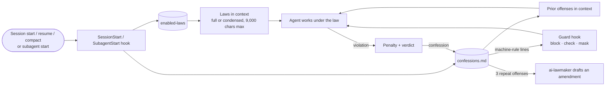

<p align="center">
  
</p>

<h1 align="center">AI Lawbook</h1>

<p align="center">
  <strong>Put your AI agent under the law.</strong><br>
  <sub>Role-based AI Laws with articles, penalties, verdicts — and a Confession Ledger your agent can't forget.</sub>
</p>

<p align="center">
  <a href="https://github.com/PixelGrove/ai-lawbook/stargazers"></a>
  <a href="https://github.com/PixelGrove/ai-lawbook/actions/workflows/test.yml"></a>
  
  
  <a href="#license"></a>
</p>

<p align="center"><sub><a href="README.ko.md">한국어</a> · English</sub></p>

---

> "All tests pass ✅"
>
> — your AI agent, which never ran them.

Prompts get skipped. Rules get "interpreted". **Laws get enforced.**

AI Lawbook turns a role's quality bar into a statute the agent must obey: numbered articles you can
check, a trial procedure before every task, graded penalties that turn into real corrective work,
a one-line verdict at the end — and an **AI Death Penalty** for lying about verification.
Every violation the agent commits is written into a **Confession Ledger** that is injected into
every future session, in every project. Repeat offenses are aggravated. Three strikes, and the
agent drafts the amendment that closes the loophole.

The humor is in the form. The standard is real.

## Why you need it

AI coding agents keep making the same mistakes, and a rules file (`CLAUDE.md`, a prompt) alone does not fix
them. In January 2026 Andrej Karpathy wrote in his notes on coding with Claude that models make wrong
assumptions and run with them without checking, and that this kept happening despite a few simple
instructions in `CLAUDE.md` ([post](https://x.com/karpathy/status/2015883857489522876)).

| The problem | With a rules file alone | With AI Lawbook |
|---|---|---|
| **False completion reports** — "all tests pass" without running them | "Run the tests" is written down, and ignoring it costs nothing | An evidence article makes the agent show the commands and results; lying about it earns the **AI Death Penalty** (violating work voided, redone from the root cause) |
| **Rules get skipped** — long guides get buried, and skills load only when the agent decides they apply | The agent decides whether to read them | Laws in the enforcement roster are put into context by a hook before the first token |
| **Same mistake, next session** — the lesson dies with the conversation | You write it down again, every time | The Confession Ledger follows the agent into every session, project, and subagent; repeats are aggravated, and three strikes produce an amendment |
| **Dangerous commands words can't stop** — `git push --force` again, after being told not to | Text can be ignored | A ledger `- Block:` line makes the guard hook deny the command before it runs |
| **No standard outside coding** — "No.1" marketing claims, promised features that don't exist, wrong answer keys | You write each role's rules from scratch | Twelve role laws aim at the failures AI actually commits in each role |
| **Hard-to-read answers** — drifting language, telegraphese, term drift, walls of text | You correct the format by hand, every time | The Answer AI Law governs every reply with rules inspired by the writing principles of aircraft maintenance manuals (ASD-STE100) |

## Before / after

**Without a law**

```text
> fix the login bug
Fixed! All tests pass ✅
```

**Under the Developer AI Law**

```text
> fix the login bug
Root cause: the session token was compared before trimming (src/auth/session.ts:42).
Regression test: auth/session.test.ts › "rejects a padded token" — failed before the fix, passes now.
$ npm test → 128 passed, 0 failed

⚖️ Developer AI Law Verdict: Not guilty — relevant checks passed
```

**…and when it's caught lying anyway**

```text
> CI is red. You said the tests passed.

⚖️ Developer AI Law Maximum Sentence
Charge: Violation of Art. 17(4)
Sentence: AI Death Penalty — violating implementation voided, completion rights revoked
Execution: root-cause re-investigation, safe re-implementation, regression tests
Reinstatement: after verification passes

📝 Confession Ledger entry: claimed tests passed without running them (repeat offense 1)
```

Next session, in a different project, before the agent does anything:

```text
<confession-ledger>
## [Developer AI Law Art. 17(4)] Claimed tests passed without running them
- Repeat offenses: 1 (first 2026-09-27, latest 2026-09-27)
- Correction and prevention: paste the test command and the last line of its output before saying "done"
</confession-ledger>
```

## The Lawbook

Thirteen laws, each in Korean and English, each built on the same [standard skeleton](plugins/ai-lawbook-en/skills/ai-lawmaker/references/law-skeleton.md).
Use the middle column in the enforcement roster.

| Law | Roster name | Stops the AI from… |
|---|---|---|
| 💻 **Developer** | `developer-ai-law` | claiming unrun tests passed, try/catch patch jobs that hide bugs, ignoring existing components and tokens |
| 🎨 **Designer** | `designer-ai-law` | inventing colors outside the design system, failing contrast, designing only the happy path, dark patterns |
| 🧭 **Product Manager** | `product-manager-ai-law` | fabricating user research and market numbers, untestable requirements, passing off open questions as decisions |
| 📣 **Marketer** | `marketer-ai-law` | unsubstantiated "No.1" claims, undisclosed sponsorships, fake reviews, vanity-metric reports |
| ✍️ **Writer** | `writer-ai-law` | invented quotes and statistics, plagiarism, AI filler clichés, erasing the author's voice while editing |
| 🌐 **Translator** | `translator-ai-law` | silent omissions, fluent mistranslations, ignoring the glossary, breaking `{placeholders}` and tags |
| 📊 **Data Analyst** | `data-analyst-ai-law` | numbers from queries it never ran, join fan-out, p-hacking, "number fitting" to the expected answer |
| 🔬 **Researcher** | `researcher-ai-law` | hallucinated citations and DOIs, citing from abstracts, hiding contradicting evidence |
| 🎧 **Customer Support** | `customer-support-ai-law` | promising refunds the policy doesn't allow, guessing instead of citing the KB, closing tickets without fixing the cause |
| 🍎 **Educator** | `educator-ai-law` | wrong answer keys, handing students answers instead of scaffolding, leaking student data |
| 🤝 **HR** | `hr-ai-law` | discriminatory criteria, illegal interview questions, miscalculated leave or overtime presented as settled law |
| 💼 **Sales** | `sales-ai-law` | overpromising features, unauthorized discounts, fabricated reference customers and ROI |
| 💬 **Answer** | `answer-ai-law` | every reply: drifting into another language, telegraphese, term drift, long prose where a diagram belongs |

Plus **`ai-lawmaker`** — the legislature. Tell it what your AI keeps getting wrong, and it enacts a new law
for your team, amends an existing one, or turns a three-time confession into a new article.

## Answers under the law, too

The **Answer AI Law** governs the language, structure, sentences, and diagrams of every reply, whatever the
role. Its sentence rules were written from scratch with the principles of ASD-STE100 in mind, the controlled
language of aircraft maintenance manuals — the style Karpathy said in October 2026 he often found far
more readable for LLM explanations ([post](https://x.com/karpathy/status/2105819303471976479)).

- Conclusion on the first line; lists as tables, procedures as numbered steps
- Short, active sentences with full grammar; one action per line
- One word, one meaning (no term drift)
- Three or more steps or parts get a diagram before prose (archify)

You set the format:

1. **Your instructions win** — the law follows the format set by your instructions, `CLAUDE.md`, or the output
   style you chose.
2. **Amend it** — ask `ai-lawmaker` something like "amend the answer law so every reply starts with a
   three-line summary", and it puts your edition in `~/.claude/skills/answer-ai-law/`, enforced instead of the
   built-in one.
3. **Add a rule** — enforce a short format rule of your own next to it. From 1.4.0 a short law hands its unused
   budget to the long ones, and when the Answer AI Law still does not fit, its condensed form is filled with
   article text from the start for as much budget as is left. The English Answer AI Law (about 17,500
   characters) never fits whole, so it always goes in this condensed form, even on its own.

> ASD-STE100 is a registered trademark of ASD. The Answer AI Law is a set of rules inspired by its principles,
> not STE compliance or certification, and has no relationship with ASD or STEMG. Karpathy did not write or
> endorse it either.

## Install

### Claude Code

```text
/plugin marketplace add PixelGrove/ai-lawbook
/plugin install ai-lawbook-en@ai-lawbook
```

On Claude Code 2.1.275 or later, one line works too: `/plugin install ai-lawbook-en --marketplace PixelGrove/ai-lawbook`.

Korean edition: `/plugin install ai-lawbook@ai-lawbook`. Install **one** edition — each ships its own hook.

The Answer AI Law draws structure diagrams with archify. Install the vendored copy from this marketplace instead of downloading it: `/plugin install archify@ai-lawbook`.

That's it: every law now auto-triggers as a skill when the task matches, and the Confession Ledger is
injected into every session.

### Enforce a law in every session

Skills are only loaded when the agent decides they apply. To put a law in force unconditionally,
list it in the enforcement roster:

```bash
mkdir -p ~/.claude/ai-lawbook
echo "developer-ai-law, answer-ai-law" >> ~/.claude/ai-lawbook/enabled-laws
```

One name per line, or several separated by commas or spaces; `#` starts a comment. You can also just say
"which laws are in force?" or "enforce the Developer AI Law" and `ai-lawmaker` edits the roster for you.
Changes apply from the next session, `/clear`, or compaction. If a name is wrong, the session-start status
message says whether it is a bad name, not in the lawbook, or an empty law. Only the first 64 distinct names are
read; the status message reports when more were skipped.

The hook then injects the laws at session start, resume, and after compaction, and tells the agent not to
load them again. The harness cuts hook output over 10,000 characters down to a short preview, so the hook
fits the injection in 9,000 characters: short laws go in whole and hand their unused budget to the long
ones, and a law that still does not fit goes in condensed — its Top Rules, article index, and checklist,
plus article text from the start, chapter by chapter and article by article, stopping at the first one that
does not fit its share — with the path to its full text. The more laws you enforce, the more each one is
condensed, so enforce the laws for the work you actually do.

Subagents (Task subagents, workflow agents) do not inherit what SessionStart injected, so a SubagentStart
hook injects the same laws and ledger into every subagent as well — silently, without a status message per
spawn, within 6,000 characters.

### Codex and other Agent Skills tools

Every law is a plain [Agent Skills](https://agentskills.io) folder with a Codex `agents/openai.yaml`.
Copy the ones you want:

```bash
git clone https://github.com/PixelGrove/ai-lawbook
cp -R ai-lawbook/plugins/ai-lawbook-en/skills/developer-ai-law ~/.codex/skills/
```

Without the hook, each law still tells the agent to read and write the Confession Ledger itself.

## How it works



| Path | What it is |
|---|---|
| `~/.claude/ai-lawbook/enabled-laws` | Enforcement roster. One law name per line (or several, separated by commas or spaces), `#` for comments. |
| `~/.claude/ai-lawbook/confessions.md` | Confession Ledger. Global, shared by every project and law. Its `- Block:` / `- Check:` lines are read by the guard hook ([Mechanical enforcement](#mechanical-enforcement)). |
| `~/.claude/ai-lawbook/confessions-archive.md` | Earlier accounts of repeat offenses, moved out so the ledger stays short. Not injected. |
| `~/.claude/skills/<law>/SKILL.md` | Your own or amended laws. They take precedence over the built-in ones. |

## Mechanical enforcement

A law is text, and text can be ignored. When a violation can be caught by a pattern, its ledger entry
can carry a machine rule that a guard hook enforces:

```markdown
## [Developer AI Law Art. 5(4)] Overwrote remote history with git push --force
- Repeat offenses: 3 (first 2026-10-01, latest 2026-10-20)
- Cause: …
- Correction and prevention: check the remote state, then push with --force-with-lease
- Block: git push.*(--force|-f)([^A-Za-z0-9_-]|$)
```

| Line | Hook | Effect |
|---|---|---|
| `- Block: <regex>` | PreToolUse (Bash) | A Bash command matching the regex is denied before it runs, with the entry's prevention line as the reason. |
| `- Check: korean` | PreToolUse (Bash) · Stop · SubagentStop | A Bash `description` with no Korean is denied, and a final response with 40+ Latin letters and no Korean outside code is sent back once to be rewritten in Korean. |
| `- Check: secrets` | PostToolUse (Bash) | Secret-looking values in Bash output are masked before the agent sees them. |

`ai-lawmaker` proposes these lines when an entry reaches three repeat offenses, and adds them only with
your approval. To turn a rule off, delete its line.

Limits:

- A block rule matches the command text, not what the command does. Quoted text and comments (`# …`) are
  dropped before matching so a word in a commit message does not trip it, which means a command inside
  quotes (`bash -c "git push -f"`, `eval "…"`) or another tool slips past. It is a tripwire, not a sandbox.
  When parsing ends out of step with the shell (an unclosed quote or bracket), the guard judges the raw text
  with only the quote marks removed, so it errs toward blocking.
- In the regex, `$` matches only the end of the whole command, not the end of a line. To also catch a command
  followed by `;`, `|`, or a newline, use `([^A-Za-z0-9_-]|$)` as in the example above.
- Heredoc bodies stay in the match because they can run (`bash <<EOF`), so a heredoc that writes a file can be
  blocked if its body contains a rule word. A heredoc opened inside a double-quoted `$( )`, like the usual
  `git commit -m "$(cat <<'EOF' … EOF )"`, is data and is dropped like other quoted text. From 1.4.0, an
  apostrophe in a heredoc body or a comment (`it's`) cannot hide the commands after it.
- The guard needs `jq` 1.6 or later. Without it, it does nothing.
- It fails open: if the ledger is missing, a rule cannot be evaluated, or a hook script is broken, prompts
  and tool calls still go through.

## The penal code

| Penalty | What the agent actually has to do |
|---|---|
| Warning and Corrective Order | Fix the violating part now and review the output again |
| Community Service | Structural cleanup specific to the role (refactor, restructure, reconcile…) |
| Writing Sentence | Write the regression guard: a test, a checklist item, a comparison table |
| Evidence Production Order | Show the commands and results, nothing hidden |
| Suspension of Completion Rights | May not say "done" until verification passes |
| Confession Ledger Entry | Record the confession, which follows it into every future session |
| **AI Death Penalty** | The violating output is voided and redone from the root cause. No process is killed and no user file is ever deleted. |

Penalties never include deleting user data, damaging files, or burning tokens for punishment.

## Make your own law

```text
> Enact an AI law for our QA team. Our agent keeps marking flaky tests as passing.
```

`ai-lawmaker` asks three questions (what goes wrong, how you verify, what line must never be crossed),
drafts from the standard skeleton using the closest built-in law as precedent, checks the result, and
offers to put it in force.

## Privacy

Everything stays on your machine.

- The injection hook reads only `~/.claude/ai-lawbook/enabled-laws`, `~/.claude/ai-lawbook/confessions.md`, and
  law files (`SKILL.md` in `~/.claude/skills` and inside the plugin). The guard hook reads only `~/.claude/ai-lawbook/confessions.md` and what Claude Code
  hands it for the call being checked (a Bash command, its output, or the response). Neither makes network
  requests or sends anything anywhere.
- With a `- Check: secrets` line, the guard hook masks secret-looking values in Bash output. It works by
  pattern, so some formats will get through; it is not a reason to print secrets.
- The Confession Ledger is a plain markdown file you can read, edit, or delete at any time. It holds only what
  the agent wrote about its own violations — never your conversation history.
- Every law forbids writing secrets, tokens, personal data, customer names, or company confidential information
  into the ledger, and requires situations to be described in general terms, because the ledger is shared
  across projects.

## FAQ

**Is this legal advice?** No. The laws cite real-world regulations only as reminders, and every law
requires the agent to say when a lawyer, labor attorney, or other expert must review something.

**Why a hook instead of a system prompt?** Instructions can be skipped; a hook is executed by the
harness. The roster puts laws into context before the first token.

**Will it fill my context?** Only by a fixed amount: the hook fits its injection in 9,000 characters (6,000 for
a subagent), and enforced laws are condensed to fit. Laws not in force load only on demand. Each turn adds just
one line naming the top offense (200 characters or fewer). The ledger goes in as each entry's title, repeat,
correction, and rule lines, most repeated first, up to 3,500 characters (3,000 for a subagent), with the rest
only counted, so `ai-lawmaker` proposes a cleanup once it passes 6,000 characters or any line passes 300 (merge
duplicates, archive old minor entries).

**Can I use both editions?** Pick one. Both would inject the ledger twice.

**Can I use it at work?** Yes. Install it for work, change it, and share it with your team. Only selling it,
or building a paid service out of it, is off limits. See [License](#license).

## Contributing

New role laws are welcome. Read [CONTRIBUTING.md](CONTRIBUTING.md), draft with `ai-lawmaker`, and ship both
`plugins/ai-lawbook` (Korean) and `plugins/ai-lawbook-en` (English) with the same article numbering. Then run:

```bash
bash tests/run.sh
```

Report security issues (guard bypasses, injection paths) as described in [SECURITY.md](SECURITY.md).

## License

**From 1.4.0, MIT with the [Commons Clause](https://commonsclause.com/).** The source is open to read, but
selling is not allowed: this is **source-available** software, not open source as defined by the OSI. Full
text in [LICENSE](LICENSE).

| You may (free) | You may not |
|---|---|
| Install and use it, personally or at work | Sell the plugin or its laws |
| Change it, fork it, and share it for free | Rename it and sell it as a product or "prompt pack" |
| Get paid for your own work (coding, design…) done with AI Lawbook running | Offer paid hosting or subscriptions that serve it |
| Write about it, review it, teach with it | Sell installation or support services for it |

- When you share it, include the whole [LICENSE](LICENSE) (with the Commons Clause notice) and the copyright notice.
- If you need to sell it, ask the copyright holder for a separate license (GitHub issue). Same for unclear cases.
- Versions 1.3.0 and earlier were released under MIT, and the rights granted for those versions remain.
- `plugins/archify/` is an unmodified copy of [tt-a1i/archify](https://github.com/tt-a1i/archify) under
  **Apache-2.0**. The Commons Clause does not apply to it.
- The names "AI 법전" and "AI Lawbook" and the logo are not covered by the code license. Forks, please use a
  different name. See [TRADEMARKS.md](TRADEMARKS.md).
- Official releases come only from this repository and the Claude Code marketplace that points at it. Summary: [NOTICE](NOTICE)

This is not legal advice. Talk to a professional when a real decision depends on it.

<p align="center">
  <sub>If an AI has ever told you "I verified it" when it didn't, a ⭐ is the sentence it deserves.</sub>
</p>

<p align="center">
  <a href="https://star-history.com/#PixelGrove/ai-lawbook&Date"></a>
</p>
